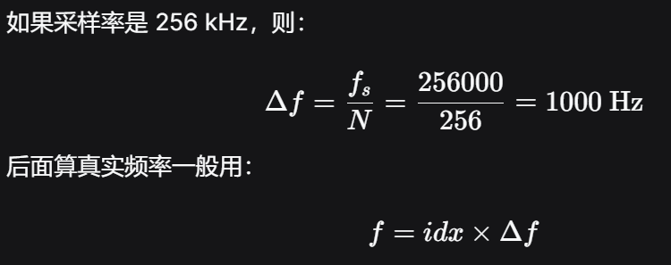
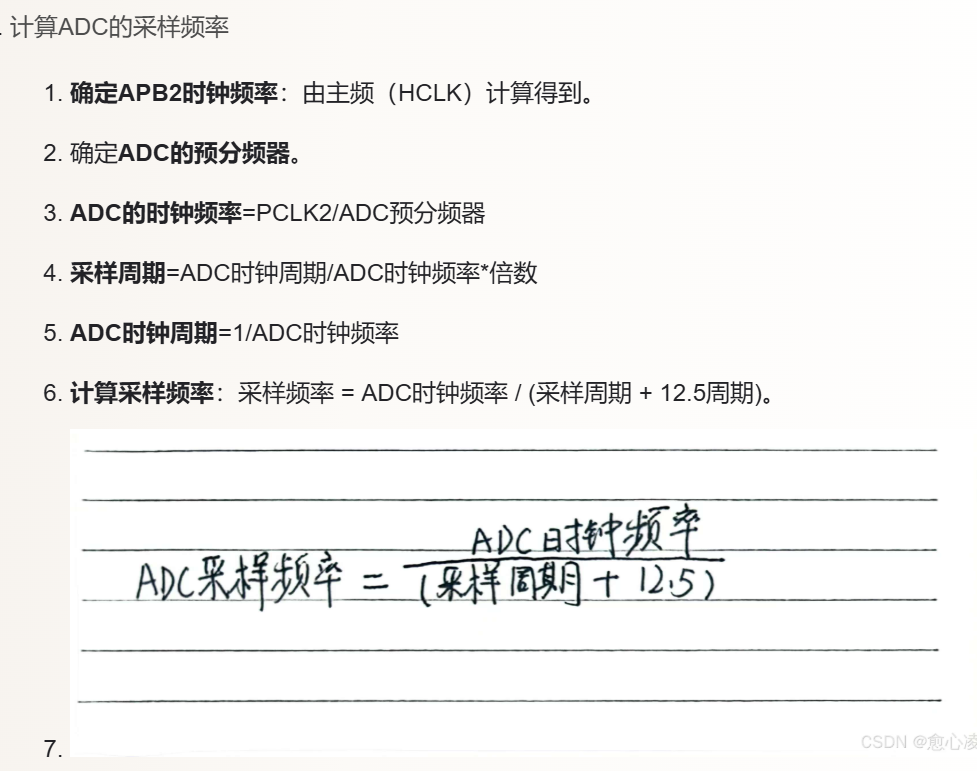
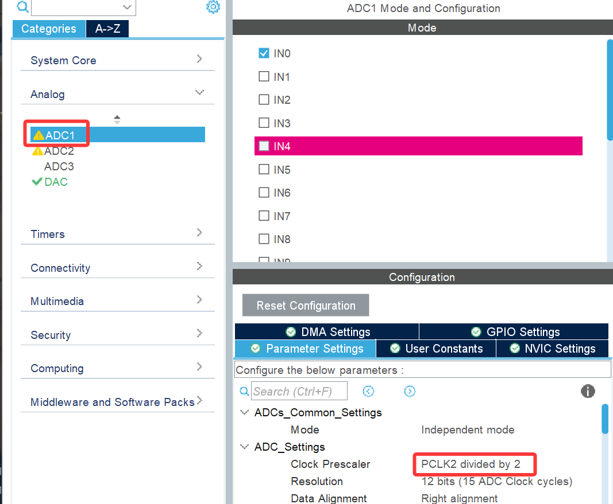
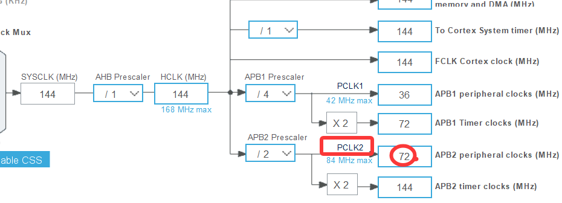
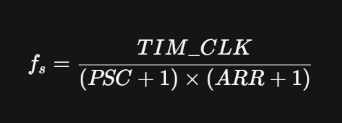
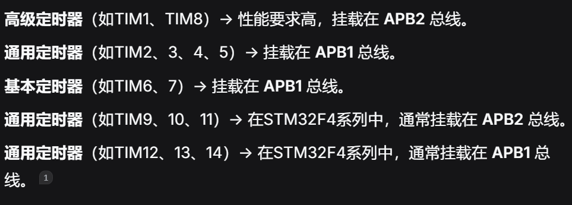
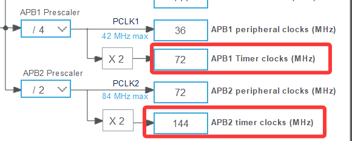

### 对 ADC 采样数据做 FFT 频谱分析，然后提取 AM/ASK/FM/PSK/FSK 等调制信号特征的程序中
#### FFT的点
```C
static float32_t deta_f_256 = 1000;
```
>256 点 FFT 的频率分辨率，即每个 FFT bin 对应的频率间隔，单位通常是 Hz。


这里就不得不提到ADC的采样率。

如图
>
>...by 2是2分频


>+ 又，ADC 不能直接跑 72 MHz。在 STM32F4 中，ADC 时钟（ADCCLK）最高通常限制在 36 MHz。
>+ 所以会有一个ADC 预分频器（Prescaler）
>+ 所以如图没有配置TIM的时候ADC的时钟频率（ADCCLK）就是36MHz。
>+ 不加TIM就没有限制它了，此时ADC容易跑到上限（采样率1.2MSPS~2MSPS）(F4)

**那么要是配置了呢？**
ADC的实际采样率 = TIM 的触发频率（也就是定时器的更新频率）

同时

还有TIM_CLK是

我的PSC=0；ARR=179。
所以ADC的采样率=72MHz/180=400KHz
>能正确识别出的最高信号频率是 200 kHz

为什么呢？
最高频率fs/2（奈奎斯特-香农采样定理）
这个有一个专有名词**频谱混叠（Aliasing）**
因为超过200KHZ，周期走不完整，会测出|输入频率−N*400KHz（采样率）|,N是正整数。
**那么接下来回到FFT**
（对了FFT的点得是2的幂数）
那么要接近100Hz的频率分辩率，应该是4096点
400KHz/4096=97.6HZ
假设ADC,TIM,DMA已经配好了。
那么代码
```C
/* 宏定义与全局变量准备 */
#include "arm_math.h"   // 包含DSP库

#define FFT_point 4096
#define SAMPLE_RATE 400000.0f // 400 kHz

// 频率分辨率 = 400k / 4096 = 97.65625 Hz
#define FFT_deta (SAMPLE_RATE / FFT_point)

// ADC DMA 接收缓存（存放原始时域数据）
static uint16_t adc_dma_buff[FFT_point]; 
// 标志位，DMA采满一帧后置1
volatile uint8_t adc_done_flag = 0;
 //uint8_t是0或者1，当bool看
//volatile每次用的时候，会去内存里重新读它的值

// FFT 输入输出缓冲区 (Cortex-M4的硬件浮点要求 float32_t)
static float32_t fft_input[FFT_point];
static float32_t fft_output[FFT_point * 2]; // FFT输出是复数，长度是点数的2倍
static float32_t mag[FFT_point / 2];        // 存幅值，FFT结果是对称的，取前一半即可

// DSP 库的 FFT 句柄（用于 4096 点 FFT）
static arm_rfft_fast_instance_f32 S;
```
>启动 DMA -> 等中断 -> 去直流 -> 跑 FFT -> 算模值 -> 找峰算频率
OK,我们已经完成了初始化，现在要启动ADC,MDA,TIM了
```C
// 初始化 DSP 库的 FFT 实例（4096点）
arm_rfft_fast_init_f32(&S, FFT_point);

// 启动 ADC 的 DMA 采集，采满 FFT_point (4096) 个点会自动触发中断
// 注意：强制转换为 uint32_t* 是 HAL 库的硬性要求
HAL_ADC_Start_DMA(&hadc1, (uint32_t*)adc_dma_buff, FFT_point);

// 启动定时器，开始输出触发信号（400 kHz）
HAL_TIM_Base_Start(&htim3); // 假设你配的是 TIM3
```

```C
/*  DMA 采满中断回调  */
void HAL_ADC_ConvCpltCallback(ADC_HandleTypeDef* hadc) {
    if(hadc->Instance == ADC1) {
        adc_done_flag = 1; // 数据到了
    }
}
```

```C
/*   去直流   */
// 1. 去直流分量
float32_t dc_mean = 0.0f;

// 求总和
for (int i = 0; i < FFT_point; i++) {
    dc_mean += (float32_t)adc_dma_buff[i];
}
// 求平均（这就是直流偏置）
dc_mean /= FFT_point; 

// 减去平均值，并将 uint16 转为 float 放入 fft_input
for (int i = 0; i < FFT_point; i++) {
    fft_input[i] = (float32_t)adc_dma_buff[i] - dc_mean;
}
```

```C
/*   运行 FFT   */
arm_rfft_fast_f32(&S, fft_input, fft_output, 0);//建议在while里面运行
// 参数说明：
// &S: 之前初始化的句柄
// fft_input: 时域输入数组
// fft_output: 频域输出数组（长度 8192）
// 0: 正向 FFT (如果是 1 就是逆向)
```

```C
/*   求模值  */
arm_cmplx_mag_f32(fft_output, mag, FFT_point / 2);//这个时候，mag 数组就变成我们要的“频谱图”了
// 参数说明：
// fft_output: 输入的复数数组 (长度 8192)
// mag: 输出的幅值数组 (长度 2048)
// FFT_point / 2: 因为频谱是对称的，我们只取前一半
```

```C
/*   找峰   */
float max_mag = 0.0f; // 记录最大幅值
int   max_idx = 0;    // 记录最大幅值对应的下标

// 从下标 5 开始找，是为了避开 0Hz 附近的直流漏泄和超低频干扰
// 循环到 2047 就行，因为 i+1 不能越界
for (int i = 5; i < (FFT_point / 2) - 1; i++) {
    
    // 判断是不是局部最大值：比左边大，且比右边大
    if (mag[i] > mag[i-1] && mag[i] > mag[i+1]) {
        
        // 如果这个峰是我们目前见过的最大值，记录下来
        if (mag[i] > max_mag) {
            max_mag = mag[i];
            max_idx = i;
        }
    }
}

// 5. 算频率 (这就是笔记里的公式)
// real_freq = 下标 * 频率分辨率 (97.65625)
float real_freq = (float)max_idx * FFT_deta;
```
**我们已经把一个简单的FFT的图跑出来了**